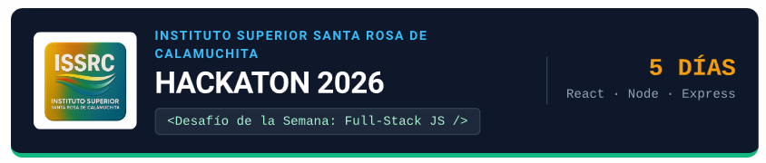
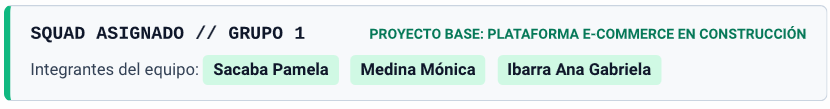
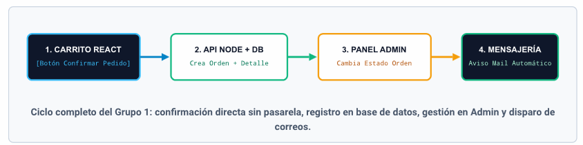
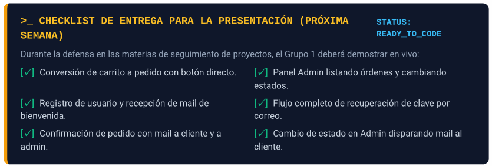

00 // BRIEFING 

# INTRODUCCIÓN GENERAL PARA LOS ESTUDIANTES

¡Bienvenidos al Desafío de la Semana: Hackaton Full-Stack JS! Durante los próximos 5 días, trabajarán en
equipos para llevar sus habilidades de desarrollo al siguiente nivel. Cada equipo recibirá una serie de
puntos estratégicos a desarrollar en un entorno que simula los desafíos reales de la industria del
software.
Este desafío único pondrá a prueba sus conocimientos en React, Node.js y Express, así como su
capacidad para integrar tecnologías modernas sobre una arquitectura existente. El objetivo no es solo
completar la tarea técnica, sino también colaborar activamente, aprender a resolver problemas bajo
presión y entregar un producto funcional, seguro y bien estructurado.
La presentación y defensa de los resultados se hará la siguiente semana en las materias afines dedicadas
al seguimiento de sus proyectos. ¡Mucha suerte y a programar!

MÓDULO A 

# FLUJO DE COMPRA Y GESTIÓN DE PEDIDOS

El corazón transaccional de todo e-commerce es la conversión del carrito de compras en una orden firme
y su posterior administración operativa. El equipo deberá construir el ciclo completo de pedidos
conectando la interfaz en React con la API en Express y la base de datos:

1. Registrar un pedido al confirmar la compra (Conversión de Carrito a Pedido): Cuando el usuario
finaliza su selección en el carrito, este se transformará en un registro de pedido persistente en la base
de datos (almacenando cliente, fecha, listado de productos con cantidades, precio unitario histórico y
monto total). Importante: No hace falta implementar una pasarela de pago externa; la operación se
concretará directamente mediante la acción del botón "Confirmar Pedido", vaciando el carrito activo y
asignando el estado inicial (ej. Pendiente).

2. Gestionar pedidos desde el Panel Administrador: Desarrollar en el panel de control (Admin) una
vista dedicada donde el administrador pueda listar todas las órdenes recibidas, inspeccionar el detalle
de ítems y datos del comprador, y actualizar el estado del pedido a medida que avanza el proceso
logístico (ej. Pendiente → En preparación → Enviado → Entregado o Cancelado).

MÓDULO B 
# SISTEMA DE MENSAJERÍA Y NOTIFICACIONES POR MAIL

En estrecha integración con el módulo de usuarios y el flujo de pedidos anterior, deberán incorporar un
servicio de envío de correos (como Nodemailer en Node.js) para automatizar la comunicación en cuatro
momentos clave:

1. Envío de mail en registro de usuario nuevo: Al darse de alta una cuenta en el e-commerce, el
servidor enviará un correo automático de bienvenida confirmando que el registro fue exitoso.

2. Recuperar contraseña (con mail): Implementar el mecanismo para usuarios que olvidaron su clave,
enviando por correo un enlace temporal o código de seguridad que les permita restablecerla de forma
confiable.

3. Generar un pedido (doble notificación al confirmar): Al presionar "Confirmar Pedido" (Punto 1 de
Pedidos), el backend enviará un mail al cliente con el comprobante de su compra y otro mail al
administrador notificando que ingresó un nuevo pedido para gestionar.

4. Notificación por cambio de estado del pedido: Cada vez que el administrador modifique el estado de
una orden desde su panel (Punto 2 de Pedidos), se disparará automáticamente un correo al cliente
informándole la novedad (ej. "Tu pedido está en preparación" o "Tu pedido fue enviado")

| **SINERGIA TÉCNICA ENTRE AMBOS MÓDULOS INTEGRACIÓN BACKEND EXPRESS**  
| Los controladores de **Pedidos** (POST /pedidos y PUT /pedidos/:id/estado) deben invocar directamente al  
| servicio de **Mensajería** tras guardar los cambios en la base de datos, garantizando que cada acción en la tienda o  
| en el panel Admin tenga su reflejo inmediato en la bandeja de entrada del usuario.

